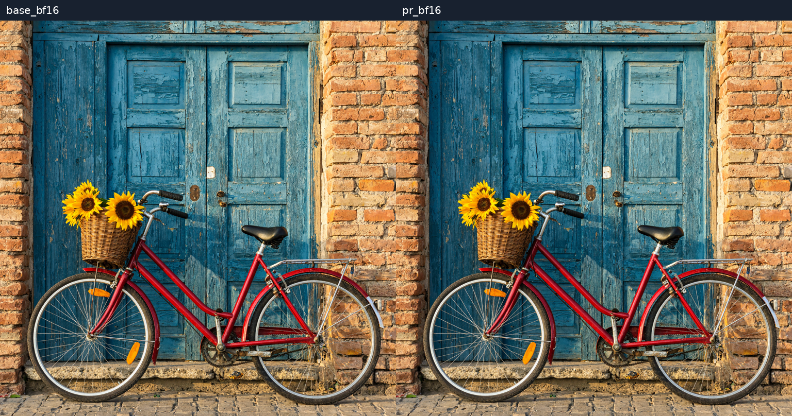
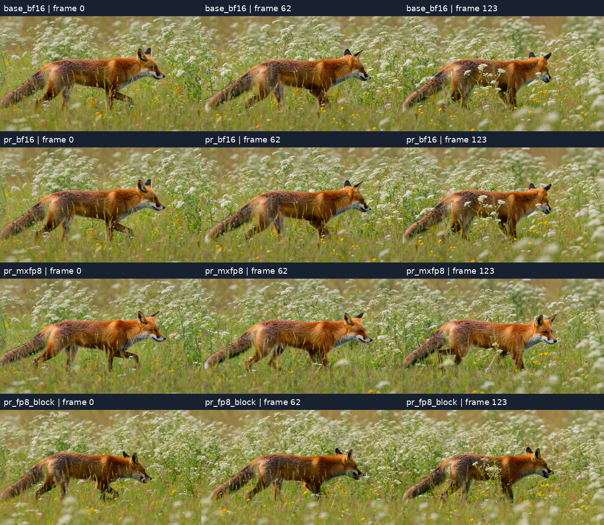
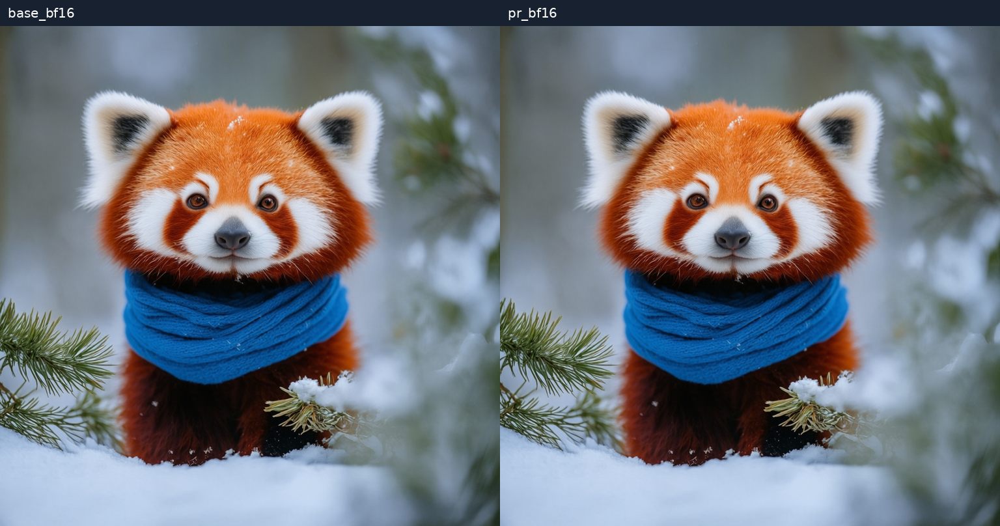
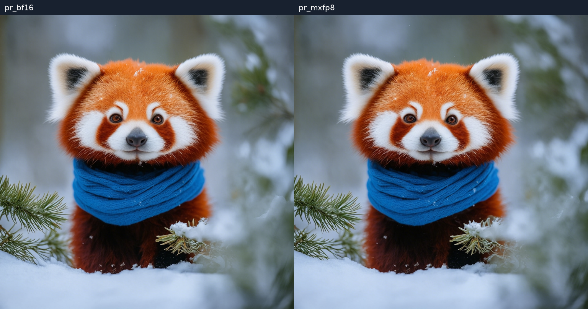
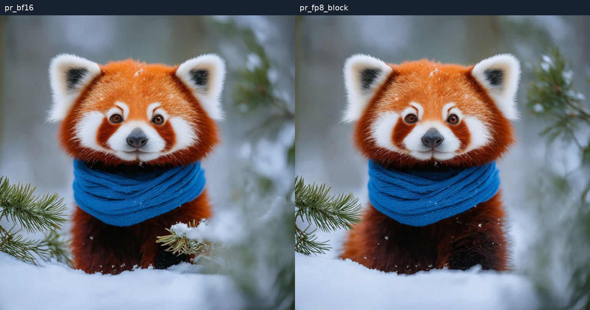
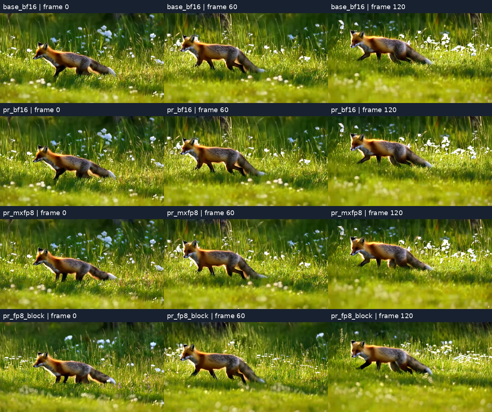

# PR #10390: generated output comparisons

Actual outputs from four NVIDIA Rubin SM107 GPUs, November 14–15, 2026. Implementation: https://github.com/vllm-project/vllm-omni/pull/10390.

Baseline `eb2077899989a07d0e7acb9cda3217734fdc8909`; tested runtime `a6a35c86b13db636a07173755b241544dff4c082`. PR head `3a3bfe15822848ada4891f505bd5f408cf162195` adds only blockwise FP8 documentation.

**Reproduce:** follow [the pinned-container command](reproduce/README.txt). Download [the scripts](reproduce.zip), or clone this evidence branch. Open `report.html` locally for the complete gallery. [Machine-readable metrics](metrics.json) include metric definitions and unavailable comparisons.

For the complete playable gallery, [download this branch as a ZIP](https://github.com/lishunyang12/vllm-omni/archive/refs/heads/agent/pr10390-quality-evidence.zip) and open `report.html`. The scripts-only ZIP is much smaller.

[Operator/interface checks and generation exit statuses](validation-summary.json) record the fresh test results. Earlier unsuccessful attempts are retained locally; the listed generation status is the final attempt for each case.

[Artifact verification](artifact-verification.json) checks all native pixel hashes, metric aggregation and every decoded frame in each MP4.

All modes use four GPUs, DiT TP1/Ulysses4, BF16 activations, eager execution; H3 text encoder TP4, other text encoders TP1. Only the diffusion transformer is quantized. Model revisions, prompts, seeds and all sampling settings are in [matrix.json](matrix.json).

SSIM uses Gaussian weighting (sigma 1.5) and population covariance. PSNR uses pooled RGB MSE. LPIPS uses AlexNet v0.1 with RGB in [-1,1]. Scores use native lossless PNG pixels; SSIM and LPIPS are averaged over every video frame. No resizing, frame truncation, or encoded MP4 input is used for scoring.

| Model | Reference → candidate | Frames | SSIM ↑ | PSNR dB ↑ | LPIPS ↓ |
|---|---|---:|---:|---:|---:|
| h3_image | base_bf16 → pr_bf16 | 1 | 1.000000 | inf | 0.000000 |
| h3_image | pr_bf16 → pr_mxfp8 | 1 | 0.573613 | 15.4368 | 0.332904 |
| h3_image | pr_bf16 → pr_fp8_block | 1 | 0.474792 | 14.3196 | 0.423636 |
| h3_video | base_bf16 → pr_bf16 | 124 | 1.000000 | inf | 0.000000 |
| h3_video | pr_bf16 → pr_mxfp8 | 124 | 0.578043 | 19.2000 | 0.339013 |
| h3_video | pr_bf16 → pr_fp8_block | 124 | 0.466565 | 17.5261 | 0.428803 |
| qwen_image | base_bf16 → pr_bf16 | 1 | 1.000000 | inf | 0.000000 |
| qwen_image | pr_bf16 → pr_mxfp8 | 1 | 0.966912 | 29.9277 | 0.041271 |
| qwen_image | pr_bf16 → pr_fp8_block | 1 | 0.924692 | 21.8433 | 0.103081 |
| wan22 | base_bf16 → pr_bf16 | 121 | 1.000000 | inf | 0.000000 |
| wan22 | pr_bf16 → pr_mxfp8 | 121 | 0.868591 | 24.5728 | 0.097001 |
| wan22 | pr_bf16 → pr_fp8_block | 121 | 0.569438 | 16.8421 | 0.320863 |

One prompt and seed per model. These scores measure output differences; they do not establish a broad quality-equivalence threshold. Viewing MP4s contain video only; H3 audio is not evaluated. First-request timings in metadata include compilation/autotuning and are not steady-state performance measurements or an SGLang comparison.

<!-- latency-start -->
**Warmed repeated-request latency:** [Rubin / GB200 comparison, raw samples and reproduction scripts](stabilized/README.md).

## First-request latency (seconds; n=1)

One first request per case on four Rubin SM107 GPUs, using the same settings and outputs as the quality matrix above. Seconds of wall time around the synchronous `Omni.generate()` call, after `Omni` initialization. Initialization/model loading is recorded separately; subsequent PNG saving, MP4 encoding and quality scoring are excluded.

| Model | Base BF16 (s) | PR BF16 (s) | PR MXFP8 (s) | PR blockwise FP8 (s) |
|---|---:|---:|---:|---:|
| MiniMax-H3-Image | 4.090 | 3.709 | 23.816 | 19.175 |
| MiniMax-H3 video | 37.652 | 33.871 | 310.963 | 72.277 |
| Qwen-Image | 8.281 | 8.377 | 51.091 | 21.305 |
| Wan2.2-TI2V-5B | 26.677 | 25.497 | 65.252 | 34.626 |

No explicit warmup request; one sample per case. Each case starts a fresh process, but persistent caches were not reset. These measurements can include first-use compilation/autotuning and have uncontrolled cache state. They are not warmed P50/P95 values, controlled cold-cache benchmarks, or an SGLang comparison. The H3 video request uses the full t2va pipeline; only video was saved and quality-scored.

The H3 MXFP8 log shows FlashInfer autotuning during this request and saving 99 new configurations per rank. This confirms autotuning activity; the run does not isolate how much of the elapsed time it consumed.

[Raw per-case timings and metadata hashes](latency.csv) · [Timing definitions](latency.json) · [Autotuning log excerpt](latency-log-excerpt.txt).

<details>
<summary>Separate initialization times</summary>

| Model | Base BF16 (s) | PR BF16 (s) | PR MXFP8 (s) | PR blockwise FP8 (s) |
|---|---:|---:|---:|---:|
| MiniMax-H3-Image | 344.224 | 292.205 | 557.885 | 324.507 |
| MiniMax-H3 video | 322.280 | 323.307 | 323.029 | 300.855 |
| Qwen-Image | 262.736 | 262.298 | 403.672 | 269.779 |
| Wan2.2-TI2V-5B | 34.741 | 34.645 | 163.022 | 40.068 |

</details>
<!-- latency-end -->

## h3_image

A red bicycle leaning against a weathered blue wooden door, a wicker basket filled with yellow sunflowers, warm afternoon sunlight, intricate wood grain and brick textures, realistic photography.

Native PNGs: [base_bf16](outputs/h3_image/base_bf16/frames/00000.png?raw=true) · [pr_bf16](outputs/h3_image/pr_bf16/frames/00000.png?raw=true) · [pr_mxfp8](outputs/h3_image/pr_mxfp8/frames/00000.png?raw=true) · [pr_fp8_block](outputs/h3_image/pr_fp8_block/frames/00000.png?raw=true)




## h3_video

A red fox walks slowly through a sunlit meadow of tall grass and white wildflowers. A gentle breeze moves the grass and the fox's fur. The camera tracks smoothly alongside the fox, realistic cinematic detail, natural lighting.



| Comparison | Synchronized video |
|---|---|
| base_bf16 → pr_bf16 | [View/download MP4](outputs/h3_video/pr_bf16/comparison.mp4?raw=true) |
| pr_bf16 → pr_mxfp8 | [View/download MP4](outputs/h3_video/pr_mxfp8/comparison.mp4?raw=true) |
| pr_bf16 → pr_fp8_block | [View/download MP4](outputs/h3_video/pr_fp8_block/comparison.mp4?raw=true) |

Individual outputs: [base_bf16](outputs/h3_video/base_bf16/video.mp4?raw=true) · [pr_bf16](outputs/h3_video/pr_bf16/video.mp4?raw=true) · [pr_mxfp8](outputs/h3_video/pr_mxfp8/video.mp4?raw=true) · [pr_fp8_block](outputs/h3_video/pr_fp8_block/video.mp4?raw=true)

## qwen_image

A small red panda wearing a blue scarf in a snowy forest, soft morning light, detailed fur, snowflakes on pine branches, realistic wildlife photography.

Native PNGs: [base_bf16](outputs/qwen_image/base_bf16/frames/00000.png?raw=true) · [pr_bf16](outputs/qwen_image/pr_bf16/frames/00000.png?raw=true) · [pr_mxfp8](outputs/qwen_image/pr_mxfp8/frames/00000.png?raw=true) · [pr_fp8_block](outputs/qwen_image/pr_fp8_block/frames/00000.png?raw=true)







## wan22

A red fox walks slowly through a sunlit meadow of tall grass and white wildflowers. A gentle breeze moves the grass and the fox's fur. The camera tracks smoothly alongside the fox, realistic cinematic detail, natural lighting.



| Comparison | Synchronized video |
|---|---|
| base_bf16 → pr_bf16 | [View/download MP4](outputs/wan22/pr_bf16/comparison.mp4?raw=true) |
| pr_bf16 → pr_mxfp8 | [View/download MP4](outputs/wan22/pr_mxfp8/comparison.mp4?raw=true) |
| pr_bf16 → pr_fp8_block | [View/download MP4](outputs/wan22/pr_fp8_block/comparison.mp4?raw=true) |

Individual outputs: [base_bf16](outputs/wan22/base_bf16/video.mp4?raw=true) · [pr_bf16](outputs/wan22/pr_bf16/video.mp4?raw=true) · [pr_mxfp8](outputs/wan22/pr_mxfp8/video.mp4?raw=true) · [pr_fp8_block](outputs/wan22/pr_fp8_block/video.mp4?raw=true)

## Availability

```json
[]
```

Still images include native PNGs and viewing previews; videos are H.264 viewing copies. Native video pixels are reproducible with the script and verified by per-frame SHA-256 checksums in each case’s metadata. Every comparison also includes per-frame scores in `quality.json`.
