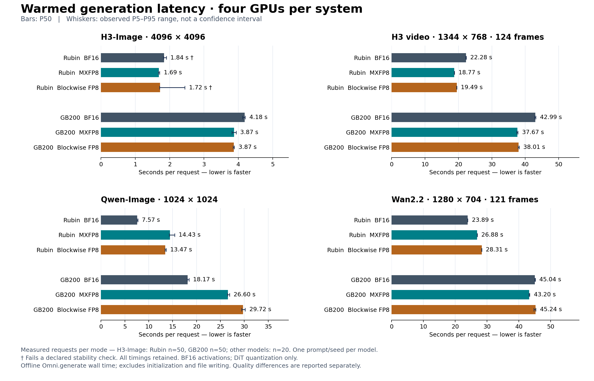

# Warmed latency comparison

**Collection complete.** Initial matrix: 32/32 complete. H3-Image confirmation: 8/8 complete.

Four GPUs per system, concurrency one, the pinned CUDA 13.4 image and unchanged model/settings from [the quality matrix](../matrix.json). Initial protocol: five warmups, then 20 measured requests in one resident engine per case. All measured requests are retained. Timings exclude initialization, frame validation, image saving and video encoding.

The H3-Image confirmation uses 15 warmups and 50 measurements for all four modes on both GPU families. It was scheduled because the initial Rubin BF16 and MXFP8 runs contained early isolated spikes. Original measurements remain below; confirmation results replace the displayed H3-Image group only when all four modes for that GPU finish.

| GPU (4 cards) | Model | PR BF16 P50 / P95 s | MXFP8 P50 / P95 s | Blockwise FP8 P50 / P95 s |
|---|---|---:|---:|---:|
| Rubin | H3-Image | 1.837 / 1.905 † | 1.689 / 1.709 | 1.720 / 2.445 † |
| Rubin | H3 video | 22.279 / 22.340 | 18.771 / 18.803 | 19.486 / 19.517 |
| Rubin | Qwen-Image | 7.569 / 7.705 | 14.433 / 15.404 | 13.465 / 13.650 |
| Rubin | Wan2.2 | 23.891 / 23.906 | 26.875 / 26.903 | 28.309 / 28.321 |
| GB200 | H3-Image | 4.185 / 4.201 | 3.874 / 3.935 | 3.868 / 3.885 |
| GB200 | H3 video | 42.990 / 43.192 | 37.675 / 37.827 | 38.014 / 38.209 |
| GB200 | Qwen-Image | 18.166 / 18.436 | 26.601 / 26.906 | 29.718 / 30.200 |
| GB200 | Wan2.2 | 45.039 / 45.122 | 43.197 / 43.398 | 45.240 / 45.337 |

† This run fails at least one declared stability check: sample CV ≤5%, first-half/second-half median change ≤5%, and P95/P50 ≤1.10. Passing is an operational check for this sample, not a confidence bound or a quality guarantee. These are offline API timings for one fixed prompt/seed per model; H3 video includes its full t2va request. They do not establish an SGLang comparison. See the [existing FP8 quality differences](../README.md).

[Primary comparison CSV](latency.csv) · [JSON](latency.json) · [Relative changes](relative-latency.json) · [Reproduce](reproduce/README.txt) · [Online serve script](reproduce/ONLINE-SERVE.txt) · [Download scripts](reproduce.zip)

Both systems use the same vLLM, PyTorch, Triton, FlashInfer, Diffusers and Transformers versions. Host drivers differ: Rubin 620.70.06, GB200 595.84.01; exact hardware and software records are included per run.

**30/32 primary cases pass all declared stability checks.** Rubin H3-Image PR BF16 and blockwise FP8 still fail at least one check in the longer confirmation; their raw samples and flags are retained. The confirmation is not selected by favorable performance.

## Latency relative to PR BF16

Negative values mean lower P50 latency. Each comparison uses the same system and model. Passing the variability checks does not establish significance for small differences.

| GPU | Model | MXFP8 change | Blockwise FP8 change |
|---|---|---:|---:|
| Rubin | H3-Image | -8.1% † | -6.3% † |
| Rubin | H3 video | -15.7% | -12.5% |
| Rubin | Qwen-Image | +90.7% | +77.9% |
| Rubin | Wan2.2 | +12.5% | +18.5% |
| GB200 | H3-Image | -7.4% | -7.6% |
| GB200 | H3 video | -12.4% | -11.6% |
| GB200 | Qwen-Image | +46.4% | +63.6% |
| GB200 | Wan2.2 | -4.1% | +0.4% |

Whiskers show the observed P5–P95 request range, not confidence intervals. [Download PNG](latency.png) · [Download SVG](latency.svg).

## Initial results

[CSV](initial/stabilized-latency.csv) · [JSON](initial/stabilized-latency.json)

| GPU | Model | Mode | n | P50 s | P95 s | CV % | Half drift % | Stable | Raw samples |
|---|---|---|---:|---:|---:|---:|---:|---|---|
| Rubin | H3-Image | pr_bf16 | 20 | 1.838 | 1.918 | 8.44 | 0.46 | no | [metadata](initial/rubin/results/h3_image/pr_bf16/metadata.json) |
| Rubin | H3-Image | pr_mxfp8 | 20 | 1.693 | 1.751 | 8.37 | 0.12 | no | [metadata](initial/rubin/results/h3_image/pr_mxfp8/metadata.json) |
| Rubin | H3-Image | pr_fp8_block | 20 | 1.720 | 1.765 | 0.96 | 0.22 | yes | [metadata](initial/rubin/results/h3_image/pr_fp8_block/metadata.json) |
| Rubin | H3-Image | base_bf16 | 20 | 1.832 | 1.873 | 0.99 | 0.26 | yes | [metadata](initial/rubin/results/h3_image/base_bf16/metadata.json) |
| Rubin | H3 video | pr_bf16 | 20 | 22.279 | 22.340 | 0.18 | 0.14 | yes | [metadata](initial/rubin/results/h3_video/pr_bf16/metadata.json) |
| Rubin | H3 video | pr_mxfp8 | 20 | 18.771 | 18.803 | 0.13 | 0.11 | yes | [metadata](initial/rubin/results/h3_video/pr_mxfp8/metadata.json) |
| Rubin | H3 video | pr_fp8_block | 20 | 19.486 | 19.517 | 0.17 | 0.16 | yes | [metadata](initial/rubin/results/h3_video/pr_fp8_block/metadata.json) |
| Rubin | H3 video | base_bf16 | 20 | 22.281 | 22.323 | 0.11 | 0.08 | yes | [metadata](initial/rubin/results/h3_video/base_bf16/metadata.json) |
| Rubin | Qwen-Image | pr_bf16 | 20 | 7.569 | 7.705 | 0.91 | 0.35 | yes | [metadata](initial/rubin/results/qwen_image/pr_bf16/metadata.json) |
| Rubin | Qwen-Image | pr_mxfp8 | 20 | 14.433 | 15.404 | 3.15 | 0.57 | yes | [metadata](initial/rubin/results/qwen_image/pr_mxfp8/metadata.json) |
| Rubin | Qwen-Image | pr_fp8_block | 20 | 13.465 | 13.650 | 0.80 | 0.18 | yes | [metadata](initial/rubin/results/qwen_image/pr_fp8_block/metadata.json) |
| Rubin | Qwen-Image | base_bf16 | 20 | 7.598 | 7.758 | 0.89 | 0.18 | yes | [metadata](initial/rubin/results/qwen_image/base_bf16/metadata.json) |
| Rubin | Wan2.2 | pr_bf16 | 20 | 23.891 | 23.906 | 0.07 | 0.04 | yes | [metadata](initial/rubin/results/wan22/pr_bf16/metadata.json) |
| Rubin | Wan2.2 | pr_mxfp8 | 20 | 26.875 | 26.903 | 0.04 | 0.02 | yes | [metadata](initial/rubin/results/wan22/pr_mxfp8/metadata.json) |
| Rubin | Wan2.2 | pr_fp8_block | 20 | 28.309 | 28.321 | 0.06 | 0.03 | yes | [metadata](initial/rubin/results/wan22/pr_fp8_block/metadata.json) |
| Rubin | Wan2.2 | base_bf16 | 20 | 23.880 | 23.914 | 0.07 | 0.09 | yes | [metadata](initial/rubin/results/wan22/base_bf16/metadata.json) |
| GB200 | H3-Image | pr_bf16 | 20 | 4.228 | 4.284 | 0.60 | 0.66 | yes | [metadata](initial/gb200/results/h3_image/pr_bf16/metadata.json) |
| GB200 | H3-Image | pr_mxfp8 | 20 | 3.905 | 3.954 | 0.61 | 0.11 | yes | [metadata](initial/gb200/results/h3_image/pr_mxfp8/metadata.json) |
| GB200 | H3-Image | pr_fp8_block | 20 | 3.920 | 3.975 | 0.93 | 0.50 | yes | [metadata](initial/gb200/results/h3_image/pr_fp8_block/metadata.json) |
| GB200 | H3-Image | base_bf16 | 20 | 4.178 | 4.267 | 1.17 | 0.60 | yes | [metadata](initial/gb200/results/h3_image/base_bf16/metadata.json) |
| GB200 | H3 video | pr_bf16 | 20 | 42.990 | 43.192 | 0.40 | 0.02 | yes | [metadata](initial/gb200/results/h3_video/pr_bf16/metadata.json) |
| GB200 | H3 video | pr_mxfp8 | 20 | 37.675 | 37.827 | 0.33 | 0.03 | yes | [metadata](initial/gb200/results/h3_video/pr_mxfp8/metadata.json) |
| GB200 | H3 video | pr_fp8_block | 20 | 38.014 | 38.209 | 0.29 | 0.10 | yes | [metadata](initial/gb200/results/h3_video/pr_fp8_block/metadata.json) |
| GB200 | H3 video | base_bf16 | 20 | 43.054 | 43.210 | 0.47 | 0.06 | yes | [metadata](initial/gb200/results/h3_video/base_bf16/metadata.json) |
| GB200 | Qwen-Image | pr_bf16 | 20 | 18.166 | 18.436 | 0.77 | 0.04 | yes | [metadata](initial/gb200/results/qwen_image/pr_bf16/metadata.json) |
| GB200 | Qwen-Image | pr_mxfp8 | 20 | 26.601 | 26.906 | 0.54 | 0.09 | yes | [metadata](initial/gb200/results/qwen_image/pr_mxfp8/metadata.json) |
| GB200 | Qwen-Image | pr_fp8_block | 20 | 29.718 | 30.200 | 0.92 | 1.38 | yes | [metadata](initial/gb200/results/qwen_image/pr_fp8_block/metadata.json) |
| GB200 | Qwen-Image | base_bf16 | 20 | 17.777 | 18.000 | 0.70 | 0.75 | yes | [metadata](initial/gb200/results/qwen_image/base_bf16/metadata.json) |
| GB200 | Wan2.2 | pr_bf16 | 20 | 45.039 | 45.122 | 0.11 | 0.09 | yes | [metadata](initial/gb200/results/wan22/pr_bf16/metadata.json) |
| GB200 | Wan2.2 | pr_mxfp8 | 20 | 43.197 | 43.398 | 0.17 | 0.07 | yes | [metadata](initial/gb200/results/wan22/pr_mxfp8/metadata.json) |
| GB200 | Wan2.2 | pr_fp8_block | 20 | 45.240 | 45.337 | 0.45 | 0.05 | yes | [metadata](initial/gb200/results/wan22/pr_fp8_block/metadata.json) |
| GB200 | Wan2.2 | base_bf16 | 20 | 44.703 | 44.741 | 0.08 | 0.05 | yes | [metadata](initial/gb200/results/wan22/base_bf16/metadata.json) |

## Confirmation results

[CSV](confirmation/stabilized-latency.csv) · [JSON](confirmation/stabilized-latency.json)

| GPU | Model | Mode | n | P50 s | P95 s | CV % | Half drift % | Stable | Raw samples |
|---|---|---|---:|---:|---:|---:|---:|---|---|
| Rubin | H3-Image | pr_bf16 | 50 | 1.837 | 1.905 | 6.64 | 0.07 | no | [metadata](confirmation/rubin/results/h3_image/pr_bf16/metadata.json) |
| Rubin | H3-Image | pr_mxfp8 | 50 | 1.689 | 1.709 | 0.92 | 0.21 | yes | [metadata](confirmation/rubin/results/h3_image/pr_mxfp8/metadata.json) |
| Rubin | H3-Image | pr_fp8_block | 50 | 1.720 | 2.445 | 12.34 | 0.07 | no | [metadata](confirmation/rubin/results/h3_image/pr_fp8_block/metadata.json) |
| Rubin | H3-Image | base_bf16 | 50 | 1.832 | 1.861 | 0.81 | 0.04 | yes | [metadata](confirmation/rubin/results/h3_image/base_bf16/metadata.json) |
| GB200 | H3-Image | pr_bf16 | 50 | 4.185 | 4.201 | 0.59 | 0.06 | yes | [metadata](confirmation/gb200/results/h3_image/pr_bf16/metadata.json) |
| GB200 | H3-Image | pr_mxfp8 | 50 | 3.874 | 3.935 | 1.37 | 0.14 | yes | [metadata](confirmation/gb200/results/h3_image/pr_mxfp8/metadata.json) |
| GB200 | H3-Image | pr_fp8_block | 50 | 3.868 | 3.885 | 0.35 | 0.06 | yes | [metadata](confirmation/gb200/results/h3_image/pr_fp8_block/metadata.json) |
| GB200 | H3-Image | base_bf16 | 50 | 4.109 | 4.193 | 0.87 | 0.21 | yes | [metadata](confirmation/gb200/results/h3_image/base_bf16/metadata.json) |

## Link to quality measurements

[Pixel-hash verification](quality-linkage.json) compares the first measured warmed Rubin output with the original quality-run output, and records whether first/last measured outputs match. This does not add a new GB200 SSIM/PSNR/LPIPS evaluation.

## Artifact audit

The [independent audit](artifact-validation.json) checked 1,040 measured requests, 280 warmups and 72 native preview PNGs, recomputed every latency summary, and verified source hashes, runtime versions and process exit status. Raw timings are preserved, including initial runs that failed stability checks.

